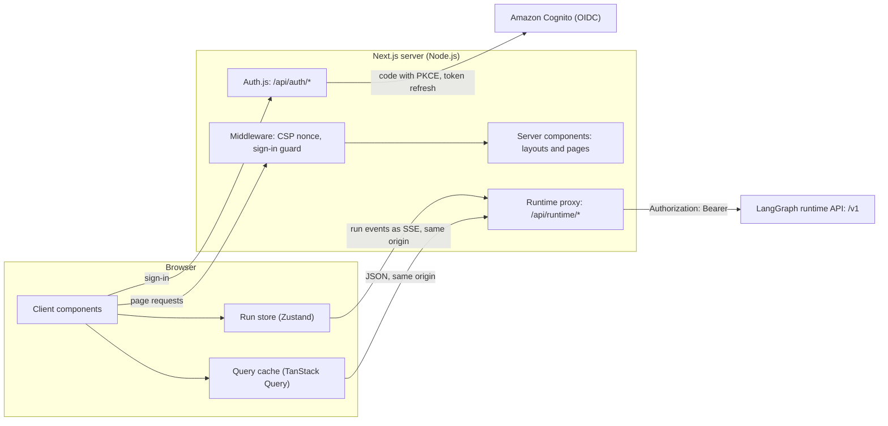
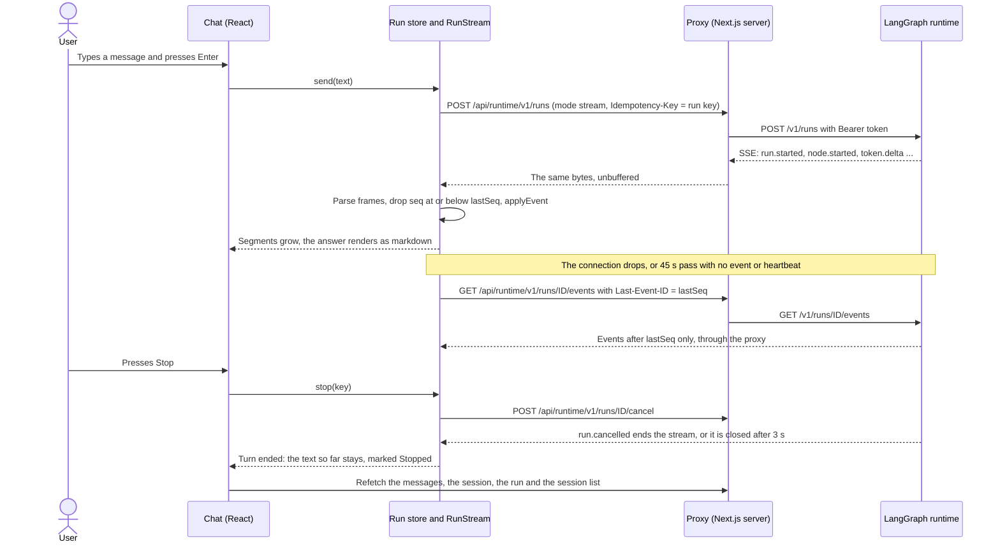
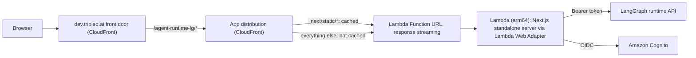

# Technical design: ZonicAgentRuntimeUI_NextJS_For_Langgraph

How this repository is built. Setup, commands and the hackathon summary are in the [README](../README.md).

How this UI is built: its structure, sign-in, the contract it is typed against, streaming, rendering, state, security, deployment and tests. The platform-wide architecture (builder, runtime, MCP server, PostgreSQL gateway) is in the [runtime's README](https://github.com/TripleQAI/ZonicAgentRuntimeBackend_Python_LangGraph#readme).

## Overview and architecture

| Layer | Choice |
|---|---|
| Framework | Next.js 15 (App Router), React 19, TypeScript |
| Sign-in | Auth.js 5 (`next-auth`) with one OIDC provider, Amazon Cognito |
| Server data | TanStack Query 5 |
| Live runs and drafts | Zustand 5 |
| Content | react-markdown with remark-gfm, AG Grid Community 36, ECharts 6 |
| Styling | Tailwind CSS 3, the TripleQ AI dark theme ([decision 0004](decisions/0004-tripleq-chat-ui-decisions.md)) |
| Tests | Vitest, Testing Library, axe-core, Playwright |

The Next.js server is a backend-for-frontend. It signs the user in, renders the pages and forwards API calls to the runtime with the user's token. After the first render the pages are client components that read the runtime API through that proxy.

| Path | Source | What it is |
|---|---|---|
| `/login` | [`src/app/(auth)/login/page.tsx`](../src/app/(auth)/login/page.tsx) | The only public page. A server action starts the OIDC sign-in. |
| `/` | [`src/app/(app)/page.tsx`](../src/app/(app)/page.tsx) | A new chat (`NewChat`): one chip per agent over the composer. `?agent=<id>` preselects an agent. |
| `/chat/[sessionId]` | [`src/app/(app)/chat/[sessionId]/page.tsx`](src/app/(app)/chat/[sessionId]/page.tsx) | A conversation (`ChatView`): saved messages, live runs, forms and the composer. |
| `/runs/[runId]` | [`src/app/(app)/runs/[runId]/page.tsx`](src/app/(app)/runs/[runId]/page.tsx) | A run (`RunTimeline`): status, tokens, cost, steps and trace. |
| `/api/auth/*` | [`src/app/api/auth/[...nextauth]/route.ts`](src/app/api/auth/[...nextauth]/route.ts) | Auth.js sign-in, callback and sign-out. |
| `/api/runtime/*` | [`src/app/api/runtime/[...path]/route.ts`](src/app/api/runtime/[...path]/route.ts) | The runtime proxy. |

The `(app)` route group's layout is an async server component. It calls `auth()`, redirects a signed-out user to `/login`, and renders the shell (`AppShell`) with the session sidebar, an error boundary and the sign-in prompt. Sign-out is a server action. Each page is a thin server component that reads its route parameters and renders one client component, keyed by the ID so that a new session or run remounts it. [`src/app/providers.tsx`](../src/app/providers.tsx) holds the client-side query cache.



### How requests reach the runtime

The browser calls `/api/runtime/...` on its own origin. That route handler reads the user's access token from the encrypted Auth.js session cookie and forwards the request to the runtime with `Authorization: Bearer ...`, streaming the response back unchanged (SSE included). The browser never holds the access token. An expiring token is refreshed on the server, and the refreshed session cookie comes back with the response.

The forwarding itself is [`src/lib/api/proxy.ts`](../src/lib/api/proxy.ts):

- Headers pass through allow lists. To the runtime: `accept`, `content-type`, `last-event-id`, `idempotency-key`, `if-none-match`, `x-request-id`. Back to the browser: `content-type`, `cache-control`, `etag`, `retry-after`, `location`, `x-request-id`, `x-accel-buffering`. Cookies never reach the runtime, and the runtime cannot set cookies on the UI's origin.
- Every request carries an `X-Request-Id`: the browser's, or a new UUID.
- The upstream body is returned as a stream (`new Response(upstream.body)`), so SSE frames are not buffered. The browser's abort signal is passed upstream, so closing a stream also closes the runtime connection.
- Redirects are not followed (`redirect: 'manual'`) and nothing is cached (`no-store`).
- Without a valid token the proxy answers `401 AUTH_REQUIRED`. When the runtime cannot be reached it answers `502 UPSTREAM_UNAVAILABLE`. Both use the runtime's error envelope, so the client handles them like any runtime error.

## Authentication and session

| Piece | Source | What it does |
|---|---|---|
| Provider | [`src/lib/auth/provider.ts`](../src/lib/auth/provider.ts) | One generic OIDC provider with the ID `tripleq`, so the callback is `/api/auth/callback/tripleq`. Issuer, client and scope come from `AUTH_OIDC_*`. It checks `pkce` and `state`. A client without a secret, such as the Cognito pool's public app client, authenticates with PKCE only (`token_endpoint_auth_method: none`). |
| Session | [`src/auth.ts`](../src/auth.ts) | `session.strategy: 'jwt'`: there is no session store. The session is a cookie encrypted with `AUTH_SECRET`. On sign-in the `jwt` callback copies the access token, refresh token and expiry into it. The `session` callback returns no token fields, so the session object the browser can read has no token. |
| Token access | [`src/lib/auth/token.ts`](../src/lib/auth/token.ts) | `accessTokenFor()` decrypts the cookie on the server (`getToken`) and returns `valid`, `missing` or `expired`. A token counts as expired 30 seconds early (`EXPIRY_SKEW_SECONDS`). |
| Refresh | [`src/lib/auth/refresh.ts`](../src/lib/auth/refresh.ts) | When a token is about to expire, the `jwt` callback finds the issuer's token endpoint by OIDC discovery and uses the refresh token grant. Cognito returns no new refresh token, so the previous one is kept. If the refresh fails, the access token is dropped and the session is marked `RefreshTokenError`, so the proxy answers 401. |

The middleware does not run on `/api/runtime`, so the proxy route refreshes the session itself. When the token has expired it runs the Auth.js callbacks (`auth({ req, res })`). It then reads the token again from the request's cookies with the new `Set-Cookie` headers applied. `applySetCookies` handles a session cookie split into chunks whose number changes. Finally it forwards the call and appends the `Set-Cookie` headers to the runtime's response. The token is written only to the encrypted cookie, never to a response body.

When the session cannot be refreshed, any 401 sets `authExpired` in the run store, from the query cache's error handler or from a stream. `SignInPrompt` then opens an `alertdialog`. Signing in returns to the same page, and the composer's draft survives because drafts are kept in session storage ([decision UB-20](decisions/0002-phase-5-ui-decisions.md)).

Why the browser never holds the token: page scripts have no token to leak, the browser and the runtime need no CORS, and SSE streams pass through the same-origin proxy unchanged ([decision UB-1](decisions/0001-phase-0-ui-decisions.md)).

**Base path.** On AWS the app is served under `/agent-runtime-lg`. That path is set once, at build time, and these pieces handle it:

| Piece | What it does |
|---|---|
| `NEXT_BASE_PATH` | [`next.config.ts`](../next.config.ts) sets Next.js's `basePath` from it and exposes it as `NEXT_PUBLIC_BASE_PATH`. |
| `withBasePath()` | [`src/lib/config/runtime.ts`](../src/lib/config/runtime.ts) adds the base path where Next.js does not: files in `public/` and the redirect targets given to Auth.js (sign-in page, post-sign-in path, sign-out). |
| `publicConfig.apiBasePath` | The proxy path the browser calls: `<base>/api/runtime`. |
| Auth.js route | Next.js passes the route handler a URL without the base path, but Auth.js expects its actions below `AUTH_URL`. The handler adds the base path back. |
| Middleware `appPath()` | Strips the base path before checking for public pages. The `callbackUrl` it sets is a path, not a URL: behind CloudFront, the host the server sees is the Lambda Function URL's. |
| `AUTH_URL` | Set to `<public URL>/api/auth` on Lambda, so Auth.js builds its redirects on the public origin. |
| `NEXT_SERVER_ACTIONS_ALLOWED_ORIGINS` | Lets the sign-in and sign-out server actions post from `dev.tripleq.ai`, which is not the host the server sees. |

## API contract and code generation

The UI uses only the runtime's published contract. Every API type is generated from it, and CI fails when the generated types and the contract drift apart.

```text
runtime: generated/openapi.json, generated/schemas/
   │  npm run sync:contract   (scripts/sync-contract.mjs)
   ▼
contract/openapi.json, contract/schemas/*.json, contract/SOURCE.json
   │  npm run gen:api         (scripts/gen-api.mjs)
   ▼
src/lib/api/generated/schema.d.ts  (openapi-typescript: paths and operations)
src/lib/api/generated/models.ts    (json-schema-to-typescript: models, events, content parts)
   │
   ▼
src/lib/api/runtime.ts  (typed calls)   src/lib/api/types.ts  (event and part unions)
```

**Vendoring** ([`scripts/sync-contract.mjs`](../scripts/sync-contract.mjs)). [`api-models.json`](../api-models.json) lists the 48 models the UI uses. The script copies them, every model they reference and the OpenAPI document into [`contract/`](../contract), which holds 89 schema files today. Models the API does not name, such as the interrupt answers `ApprovalAnswer` and `InputAnswer`, come from the runtime's `generated/schemas/<group>/`. [`contract/SOURCE.json`](../contract/SOURCE.json) records the runtime commit (with `-dirty` when its `generated/` folder has uncommitted changes) and a SHA-256 hash for each file. CI reads only `contract/`, so it needs no access to the runtime repository, and every contract change arrives as a reviewed diff.

**Wire-type rules** ([`scripts/gen-api.mjs`](../scripts/gen-api.mjs)). The runtime's schemas are Pydantic validation schemas: a field with a default is optional, whether or not the server always sends it. The generator types each model by how it travels:

| Model | Found by | Typed as |
|---|---|---|
| Request bodies | Reached from any operation's `requestBody`, plus `ApprovalAnswer` and `InputAnswer` | The schema unchanged |
| HTTP response models | Reached from any operation's `responses`, stopping at `RunEvent` | Every field that cannot be null is required. The runtime drops only nulls from responses (`response_model_exclude_none`), so these fields are always present. |
| Events and content parts | Everything else | Only the `type` discriminator (a `const`) is required. Other optional fields stay optional, because events can be built as plain dicts. |
| Pydantic `Any` fields | A property with no type keywords | `unknown`, not an empty object type |

**Drift check.** `npm run gen:api:check` generates the files in memory and fails if they differ from the committed ones. CI runs it. [`tests/unit/contract/generated-client.test.ts`](../tests/unit/contract/generated-client.test.ts) runs the same check and compares every vendored file with its hash in `SOURCE.json`. [`tests/unit/principles/contract-types.test.ts`](../tests/unit/principles/contract-types.test.ts) type-checks the API modules, the run store and the timeline against the generated types. It also checks that a renamed path or a changed event model fails that type check, and that every path the UI calls is in the vendored OpenAPI document.

**The API layer** ([`src/lib/api/`](../src/lib/api)):

- [`client.ts`](../src/lib/api/client.ts): the fetch wrapper used for every call. It sends JSON bodies and a new `X-Request-Id` per request, and turns every failure into one `ApiError` (status, code, message, request ID, `retryable`, field `details`) built from the runtime's error envelope. A failure with no response becomes `NETWORK_ERROR`, which can be retried. An empty success body (`201` from feedback) returns `undefined`.
- [`runtime.ts`](../src/lib/api/runtime.ts): the typed calls. Its `PATHS` table `satisfies Record<string, keyof paths>`, and each call's body and response types are derived from the generated operation, so a path or model the runtime renames is a compile error.
- [`types.ts`](../src/lib/api/types.ts): the `ContentPart` union, a map from event type to data model (`RunEventData`), `TypedRunEvent`, and the events that end a turn (`run.completed`, `run.failed`, `run.cancelled`, `run.waiting`). `asContentPart()` turns any part of an unknown type into a `json` part.

| Call | Runtime endpoint |
|---|---|
| Agent catalog | `GET /v1/catalog/agents` |
| Sessions: list, create, read, rename or archive | `GET` and `POST /v1/sessions`, `GET` and `PATCH /v1/sessions/{sessionId}` |
| Messages | `GET /v1/sessions/{sessionId}/messages` |
| Start a run (stream mode) | `POST /v1/runs` with `Accept: text/event-stream` and an `Idempotency-Key` |
| Reattach to a run's events | `GET /v1/runs/{runId}/events` with `Last-Event-ID` |
| Run, node timeline, trace | `GET /v1/runs/{runId}`, `/nodes`, `/trace` |
| Stop | `POST /v1/runs/{runId}/cancel` |
| Interrupts: list and answer (stream mode) | `GET /v1/runs/{runId}/interrupts`, `POST /v1/runs/{runId}/interrupts/{interruptId}` |
| Dataset pages for grids and charts | `GET /v1/datasets/{datasetId}?page&pageSize&sort&filter` |
| Feedback | `POST /v1/messages/{messageId}/feedback` |

### Differences from the Node.js contract

The UI follows the LangGraph runtime where its contract differs (its `docs/contract-review.md`):

- **Node timeline** (`GET /v1/runs/{runId}/nodes`): `TimelineEntry` names no node and carries no input or output, so a run rebuilt from it shows the node ID as the name, and the run page has no "node inputs and outputs" section.
- **Node status**: `succeeded`, `failed`, `interrupted`, `continued` (Node.js: `completed`, `failed`).
- **Error details**: `{path, message, type}`; a form shows `message` beside its field (Node.js: `constraints`).
- **Optional fields**: the runtime's schemas mark defaulted fields optional. `scripts/gen-api.mjs` makes them required in HTTP response models, which always send them; events and content parts can omit them, so the renderers fall back to empty values.

## Chat and streaming



**Sending.** The composer calls the run store's `send()`. It creates a live run under a new client key, which also serves as the `Idempotency-Key`, and starts `RunStream.start()` with `POST /v1/runs` in `stream` mode. A new chat sends no session ID. The runtime creates the session and names it in `run.started`, and the home page then navigates to `/chat/<sessionId>`. The live run stays in the store, so its stream continues across that navigation ([decision UB-11](decisions/0002-phase-5-ui-decisions.md)).

**Parsing.** [`src/lib/stream/sse.ts`](../src/lib/stream/sse.ts) parses the event-stream format incrementally. It handles chunks split anywhere (including inside a UTF-8 sequence), CR, LF and CRLF line ends, multi-line `data` and comments. `RunStream` skips heartbeat frames, which only reset its idle timer.

**Reconnecting without duplicates** ([`src/lib/stream/run-stream.ts`](../src/lib/stream/run-stream.ts), [decision UB-10](decisions/0002-phase-5-ui-decisions.md)):

- Each event carries a `seq`. Any event at or below the last `seq` seen is dropped, both in `RunStream` and again in the store's `applyEvent()`.
- A stream that ends without a turn-ending event, or stays quiet for `idleTimeoutMs`, is reopened with exponential backoff: `reconnectDelayMs × 2^(attempt−1)`, for up to `reconnectAttempts` tries. The counter resets when a reconnect delivers new events.
- Once the run ID is known, the stream reopens with `GET /v1/runs/{runId}/events` and `Last-Event-ID`. Before that, the start request is repeated with the same `Idempotency-Key`, and the runtime replays the same run.
- Only failures with no answer from the runtime are retried: no response, 502 or 504. A refusal (`OVERLOADED`, `RATE_LIMITED`, `RUN_IN_PROGRESS`) is shown with a Retry button, so load shedding is not met with more load.
- A `stream.gap` event means the runtime lost events. The run is flagged, and the saved messages loaded at the end of the turn become the record.

| Stream setting (`publicConfig.stream`) | Default | Override |
|---|---|---|
| `reconnectAttempts` | 5 | `NEXT_PUBLIC_STREAM_RECONNECT_ATTEMPTS` |
| `reconnectDelayMs` | 500 | `NEXT_PUBLIC_STREAM_RECONNECT_DELAY_MS` |
| `idleTimeoutMs` | 45,000 | `NEXT_PUBLIC_STREAM_IDLE_TIMEOUT_MS` |
| `cancelWaitMs` | 3,000 | `NEXT_PUBLIC_STREAM_CANCEL_WAIT_MS` |

**Rendering tokens.** `applyEvent()` in [`src/store/run.ts`](../src/store/run.ts) appends each `token.delta` to the last text segment when it comes from the same node and swarm member, and starts a new segment otherwise. `LiveRunView` renders each segment as markdown as it grows. When more than one node or swarm member has streamed text, each segment is labelled with its member or node, which shows which agent answered. `content.part` events add parts, `interrupt.requested` adds a pending form, and `warning` events add a list of warnings.

**Stop.** `stop()` calls `POST /v1/runs/{runId}/cancel` and waits up to `cancelWaitMs` for `run.cancelled`, then closes the stream. The text so far stays and is marked Stopped ([case U-03](../tests/e2e/chat.spec.ts)).

**End of a turn.** When a run completes, fails, is cancelled or waits for input, the query cache refetches the session's messages, the session, the run and the session list. `liveVisibility()` in [`ChatView`](../src/components/chat/ChatView.tsx) hides a live run's input and answer once the saved versions have loaded, so the chat never shows a message twice. A stopped or failed run's live text stays in the tab.

**Reopening a chat.** `ChatView` reads the run of the newest saved message. If it is `queued` or `running`, the store attaches to its event stream. If it is `waiting_input`, the chat lists its pending interrupts and shows their forms.

**Steps and the run timeline** ([`src/lib/timeline.ts`](../src/lib/timeline.ts)). The store keeps only the events the timeline needs: `node.*`, `tool.*`, `swarm.member.*`, `swarm.handoff`, `loop.iteration`, `interrupt.requested` and `warning`. Token and state events are left out to bound memory. `stepsFromEvents()` builds the steps in event order and pairs each finish with its start: a node by path and node ID, a tool call by `toolUseId`, a swarm member by name. Handoffs (from and to members), loop iterations, pauses and warnings are single steps. Under each live answer the steps sit in a collapsed `<details>` element (`RunSteps`). The run page (`RunTimeline`) replays the run's events from the start of the runtime's replay buffer. If the events are gone, or a `stream.gap` arrives, it falls back to `stepsFromVisits()` over `GET /v1/runs/{runId}/nodes`. It also shows token usage and cost, polls the run every 4 seconds by default (`reconnectDelayMs × 8`) until it reaches a final status, and shows the trace tree (`TraceTree`: spans, generations and events with latency, model, tokens and cost). The runtime returns the trace only to trace roles; the page hides it on 403 or 404.

## Rendering content parts

An agent's answer is a list of typed content parts. [`src/components/content/renderers/index.tsx`](../src/components/content/renderers/index.tsx) maps each part type to one renderer. Its type, `RendererRegistry`, is a mapped type over the contract's part types, so a missing renderer is a compile error. `PartView` wraps each part in `Suspense`. AG Grid and ECharts are lazy-loaded, so they download only when a message contains a grid or chart.

| Part | Renderer | Behaviour |
|---|---|---|
| `markdown` | `MarkdownRenderer` | GitHub-flavoured markdown. Raw HTML is skipped, not rendered (`skipHtml`). Only `http(s):`, `mailto:`, `#` and same-origin paths survive as URLs. Links open with `noopener noreferrer nofollow`. Images show their alt text. |
| `table` | `TableRenderer` | Rows sent inline, up to the runtime's inline row limit. Has a `<caption>` and column headers. |
| `grid` | `GridRenderer` (lazy) | AG Grid's infinite row model over `GET /v1/datasets/{id}`. Each block of `pageSize` rows is one page. The first sorted column becomes `sort` (`field` or `field:desc`) and text "contains" filters become `filter`, so the runtime sorts and filters the whole dataset ([`src/lib/grid.ts`](../src/lib/grid.ts)). Column definitions pass an allow list; renderers and code are dropped. |
| `chart` | `ChartRenderer` (lazy) | ECharts with the SVG renderer and its dark theme. The option is copied again as plain JSON, so functions are dropped. A chart that names a dataset but has no `dataset.source` gets the dataset's first 100 rows ([`src/lib/chart.ts`](../src/lib/chart.ts)). |
| `card` | `CardRenderer` | Title, markdown body and labelled fields. Actions are listed but not run: the contract has no action endpoint ([decision UJ-4](decisions/0002-phase-5-ui-decisions.md)). |
| `json` | `JsonRenderer` | A collapsible viewer whose summary shows the value's shape. It also shows any part of an unknown type. |
| `file` | `FileRenderer` | A download link for a runtime API path (fetched through the proxy, which adds the token) or an `https:` URL. Anything else shows the name only. |
| `html` | `HtmlRenderer` | HTML the runtime has already sanitized, shown in an `iframe` with an empty `sandbox` (no scripts, forms or navigation) and `referrerPolicy="no-referrer"`. This is the only place server HTML reaches the page. |
| `citation` | `CitationRenderer` | The source's title linked through the same URL allow list as markdown, with the quoted snippet. |
| `error` | `ErrorRenderer` | The UI catalog's message for the error code when it has one (`apiError.<CODE>`), else the runtime's user-safe message, plus the code for support. |
| `form` | `FormRenderer` | The interrupt the part names, answered like any interrupt. It is hidden once the run no longer waits. |

**Interrupts: human input and approval** ([`src/lib/schema-form.ts`](../src/lib/schema-form.ts), [`src/components/interrupts/`](../src/components/interrupts), [decision UB-14](decisions/0002-phase-5-ui-decisions.md)). A paused run sends `interrupt.requested` with a JSON Schema for the answer, and the form is generated from that schema:

- If the schema has an `approved: boolean` property, the form shows Approve and Reject buttons plus any other fields, such as a comment.
- Otherwise each property becomes a field: text, long text, number, integer, checkbox, choice (from `enum`) or JSON. Defaults prefill the fields.
- Before sending, the form checks required fields, numeric bounds, length, `pattern` and JSON syntax. If the runtime rejects the answer, each error in `details[].path` is shown beside its field.
- The answer goes to `POST /v1/runs/{runId}/interrupts/{interruptId}` in `stream` mode, and the resumed turn streams into the same live run.
- When a form appears, focus moves to its heading. While the run waits, the composer is disabled. Once the form is answered, focus returns to the composer.

## State management

| State | Where | Why |
|---|---|---|
| Runtime data: agents, sessions, messages, runs, node timelines, traces, interrupts, dataset pages | TanStack Query cache ([`src/app/providers.tsx`](../src/app/providers.tsx)) | Caching, cursor paging and refetching after a turn. `retry: false` and `refetchOnWindowFocus: false`: errors are shown with a Retry button instead of being retried silently. |
| Live runs | Zustand run store ([`src/store/run.ts`](../src/store/run.ts)), keyed by client run key. The `RunStream` objects live in a `Map` beside the store, outside React. | A stream survives navigation and re-renders. Components subscribe with selectors (`selectSessionRuns`) and `useShallow`. |
| Unsent drafts | Zustand with `persist` to `sessionStorage` ([`src/store/drafts.ts`](../src/store/drafts.ts)), keyed by session ID or `new:<workflow>` | Typed text survives a reload or a sign-in after an expired session. |

The query keys are `['agents']`, `['sessions', status, q]`, `['session', id]`, `['messages', sessionId]`, `['run', runId]` (plus `'nodes'` and `'trace'`), `['interrupts', runId]` and `['dataset', id, ...]`. When a turn ends, the run store notifies its listeners, and the providers invalidate the session's messages, the session, the run and every `['sessions', ...]` query.

**Session sidebar** ([`src/components/sidebar/SessionSidebar.tsx`](../src/components/sidebar/SessionSidebar.tsx)). It is an infinite query with cursor paging (20 sessions per page). Search waits 300 ms after the last keystroke, and there are Active and Archived filters. Rename and archive are mutations: on success they invalidate the session list and write the updated session into the cache. Archiving the open chat returns to the home page. On narrow screens the sidebar is a drawer.

**Messages.** The chat loads 50 messages per page, with a "Load earlier" button for older pages. `orderedMessages()` removes duplicates by message ID, because pages overlap when new messages arrive, and sorts them by `seq`.

## Security

**Content Security Policy** ([`src/middleware.ts`](../src/middleware.ts), [`src/lib/security/csp.ts`](../src/lib/security/csp.ts), [decision UC-1](decisions/0003-phase-6-ui-decisions.md)). The middleware creates a nonce for each request (16 random bytes, base64) and sets the policy on both the request and the response. Next.js reads the request header and puts the nonce on its own scripts. The root layout awaits `headers()`, so every page renders per request and gets its own nonce.

| Directive | Value |
|---|---|
| `default-src` | `'self'` |
| `script-src` | `'self' 'nonce-<per request>' 'strict-dynamic'`. No `'unsafe-inline'`. `next dev` adds `'unsafe-eval'`. |
| `style-src` | `'self' 'unsafe-inline'` plus `CSP_STYLE_ORIGINS` (default Google Fonts). React style attributes, the grid and the chart set inline styles. |
| `font-src` | `'self'` plus `CSP_FONT_ORIGINS` |
| `img-src` | `'self' data: blob:` |
| `connect-src` | `'self'`. The browser talks only to its own origin. |
| `frame-src` | `'self'` |
| `object-src`, `frame-ancestors` | `'none'` |
| `base-uri` | `'self'` |

The middleware also guards every page except `/login`. Auth.js routes, the runtime proxy (which checks its own token) and static files are excluded by its matcher.

**Untrusted content.** Agent output is data, not markup. Markdown drops raw HTML and unsafe URLs. HTML views run in an iframe sandboxed without any permission. Chart options are copied as plain data. Grid column definitions pass an allow list. File links are limited to runtime paths and `https:`. Card actions run nothing.

**Proxy.** Header allow lists apply in both directions. The target path is built from URL-encoded segments under `RUNTIME_API_URL`. Redirects are not followed, and the token is added on the server only. Sign-in uses PKCE and `state`. `poweredByHeader` is off.

The end-to-end suite records every `securitypolicyviolation` event while chatting and checks that the policy has a nonce, no inline scripts and a new nonce on every request ([`tests/e2e/security.spec.ts`](../tests/e2e/security.spec.ts)).

## Configuration and deployment

[`src/lib/config/runtime.ts`](../src/lib/config/runtime.ts) is the only application module that reads the environment; `next.config.ts` reads the build-time settings. It exposes three groups of settings. `serverConfig()` covers server-only values and throws when a required one is missing. `cspConfig()` covers the policy's extra origins. `publicConfig` covers browser-safe values, which are fixed at build time. Paging, debounce and size constants also live there instead of in components.

| Variable | When | Purpose |
|---|---|---|
| `RUNTIME_API_URL` | Run time | The LangGraph runtime the proxy forwards to |
| `AUTH_SECRET` | Run time | The key that encrypts the session cookie |
| `AUTH_OIDC_ISSUER`, `AUTH_OIDC_CLIENT_ID` | Run time | The OIDC issuer (the Cognito user pool) and app client |
| `AUTH_OIDC_CLIENT_SECRET`, `AUTH_OIDC_SCOPE` | Run time | Optional. Without a secret the client uses PKCE only. The scope defaults to `openid email profile`. |
| `AUTH_URL`, `AUTH_TRUST_HOST` | Run time | Auth.js: the public origin and base path when behind a proxy |
| `CSP_STYLE_ORIGINS`, `CSP_FONT_ORIGINS` | Run time | Extra policy origins |
| `NEXT_BASE_PATH`, `NEXT_SERVER_ACTIONS_ALLOWED_ORIGINS`, `NEXT_OUTPUT` | Build time | Base path, server-action origins, standalone output |
| `NEXT_PUBLIC_FEATURE_ATTACHMENTS`, `NEXT_PUBLIC_STREAM_*` | Build time | The attachments flag (off) and the stream settings |

### Container image

`docker build -t zonic-agent-runtime-ui-langgraph .` builds the Next.js standalone server (port 3000). Give it the same variables as `.env.example` at run time; `NEXT_PUBLIC_*` values are fixed at build time. The runtime's own deployment: [docs/runbooks/deploy.md](https://github.com/TripleQAI/ZonicAgentRuntimeBackend_Python_LangGraph/blob/main/docs/runbooks/deploy.md) in the runtime repository.

The [`Dockerfile`](../Dockerfile) has two stages on `node:22-slim`: `npm ci` and `next build` with `NEXT_OUTPUT=standalone`, then a runtime stage that copies `.next/standalone`, `.next/static` and `public/`, and runs `node server.js` as the `node` user.

### On AWS

The live chat at https://dev.tripleq.ai/agent-runtime-lg runs on AWS Lambda behind CloudFront, chosen for the lowest standing cost: no VPC, load balancer or always-on compute. Everything is in [`deploy/aws-lambda/`](../deploy/aws-lambda).



- **Image** ([`deploy/aws-lambda/Dockerfile`](../deploy/aws-lambda/Dockerfile)). The same standalone server, built for arm64 with `NEXT_BASE_PATH=/agent-runtime-lg`, plus the AWS Lambda Web Adapter extension. With `AWS_LWA_INVOKE_MODE=response_stream`, the adapter streams responses, so a run's SSE passes through Lambda. `.next/cache` is linked to `/tmp`, because Lambda's filesystem is otherwise read-only.
- **Stack** ([`deploy/aws-lambda/cdk/lib/runtime-ui-stack.ts`](../deploy/aws-lambda/cdk/lib/runtime-ui-stack.ts)):
  - The function has 1024 MB and a 15-minute timeout, because a run's event stream passes through the proxy for as long as the run lasts.
  - Its Function URL uses the `RESPONSE_STREAM` invoke mode.
  - CloudFront caches `<base>/_next/static/*`. Everything else passes through uncached, with every viewer header except `Host`.
  - A CloudFront Function redirects `<base>/` to `<base>` with a relative location, so the browser stays on the public host.
  - `AUTH_SECRET` is an SSM SecureString, generated on the first deploy and passed as a `NoEcho` CloudFormation parameter.
- **Deploy** ([`deploy/aws-lambda/deploy.sh`](../deploy/aws-lambda/deploy.sh)). Builds and pushes the image to ECR (keeping the five newest images), synthesizes the template with CDK and deploys it with `aws cloudformation deploy`, so no CDK bootstrap is needed. It then checks that the Cognito app client lists the callback URL `<public URL>/api/auth/callback/tripleq`. Finally, a smoke test expects:
  - the sign-in page to load
  - the home page without a session to redirect to sign-in
  - the proxy without a session to answer 401
- **Front door.** `dev.tripleq.ai` is a separate CloudFront distribution, outside this repository. It routes each app's path to that app's own distribution.

## Accessibility and testing

**Accessibility (case U-12)**:

- The streamed answer is in a polite live region marked `aria-busy` while text arrives.
- A visually hidden status region announces when the agent is responding, reconnecting, waiting for input, done, failed or stopped.
- Interrupt forms connect each field to its help text and error with `aria-describedby` and set `aria-invalid` and `aria-required`.
- Focus moves to a new form, back to the composer afterwards, into the sidebar drawer when it opens, and back to the toggle on Escape.
- Contrast meets WCAG AA on the dark theme ([decision UD-2](decisions/0004-tripleq-chat-ui-decisions.md)).
- Every user-facing string comes from [`messages/en.json`](../messages/en.json) through `t()` ([`src/lib/i18n/t.ts`](../src/lib/i18n/t.ts)), whose keys are type-checked.

| Layer | Tools | What it covers |
|---|---|---|
| Unit and component | Vitest (jsdom), Testing Library, user-event: 20 files in [`tests/unit/`](../tests/unit) | SSE parsing, the stream client and run store (reconnect, dedupe, stop), the API client and proxy, token refresh, CSP, renderers, forms, sidebar, timeline. A fake runtime ([`tests/unit/support/fake-runtime.ts`](../tests/unit/support/fake-runtime.ts)) stands in for the API. |
| Accessibility in components | axe-core with the WCAG 2.1 A and AA rules ([`tests/unit/support/axe.ts`](../tests/unit/support/axe.ts)) | Catalog, chat, interrupts, renderers, sidebar and timeline. Colour contrast and frames are left to the browser suite, because jsdom has no layout. |
| Principles | [`tests/unit/principles/`](../tests/unit/principles) | Generated contract types (above), and a scan of every component for literal user-facing text (JSX text, `aria-label`, `title`, `placeholder`, `alt`, `label`) |
| End to end | Playwright: 8 specs in [`tests/e2e/`](../tests/e2e), on desktop Chrome and a Pixel 7 | Cases U-01 to U-13 and X-07: streaming, stop, reconnect, errors, expired sessions, content parts, grid paging, forms, sidebar, timeline, message actions, CSP. Axe runs in Chromium with contrast included. |

**CI** ([`.github/workflows/ci.yml`](../.github/workflows/ci.yml)) runs on pull requests, on pushes to `main` and on manual dispatch, using Node 22. Its steps are `npm ci`, lint, typecheck, `gen:api:check`, `npm test` and `npm run build`. There is no end-to-end job yet; see [End-to-end tests](../README.md#end-to-end-tests).

## Key design decisions

| ID | Decision | Record |
|---|---|---|
| UB-1 | The browser calls a same-origin proxy that adds the token on the server; the session sent to the browser has no token | [0001](decisions/0001-phase-0-ui-decisions.md) |
| UB-3 | Auth.js middleware runs on the Node.js runtime | [0001](decisions/0001-phase-0-ui-decisions.md) |
| UB-7 | The runtime contract is vendored in `contract/` with hashes; CI needs no runtime access | [0001](decisions/0001-phase-0-ui-decisions.md) |
| UB-8 | Silent token refresh in the Auth.js `jwt` callback, 30 seconds before expiry | [0001](decisions/0001-phase-0-ui-decisions.md) |
| UB-10 | Stream client: dedupe by `seq`, reconnect with `Last-Event-ID`, retry only transport failures | [0002](decisions/0002-phase-5-ui-decisions.md) |
| UB-11 | Live runs in a store outside React; saved messages are the record after a turn | [0002](decisions/0002-phase-5-ui-decisions.md) |
| UB-12 | Export to PDF through a print stylesheet, without a PDF library | [0002](decisions/0002-phase-5-ui-decisions.md) |
| UB-14 | Interrupt forms generated from the answer's JSON Schema, with server errors shown inline | [0002](decisions/0002-phase-5-ui-decisions.md) |
| UB-16, UB-17 | Grid paged, sorted and filtered on the server; chart option copied as plain data | [0002](decisions/0002-phase-5-ui-decisions.md) |
| UB-18 | Axe in component tests and in the browser; no literal user-facing text | [0002](decisions/0002-phase-5-ui-decisions.md) |
| UB-20 | An expired session shows a sign-in prompt; drafts are kept in session storage | [0002](decisions/0002-phase-5-ui-decisions.md) |
| UB-23 | A public OIDC client uses PKCE only | [0002](decisions/0002-phase-5-ui-decisions.md) |
| UC-1 | A CSP with a nonce per request and no inline scripts | [0003](decisions/0003-phase-6-ui-decisions.md) |
| UC-2 | The middleware redirects to sign-in with a path, not a URL, as `callbackUrl` | [0003](decisions/0003-phase-6-ui-decisions.md) |
| UC-3 | A standalone server container image | [0003](decisions/0003-phase-6-ui-decisions.md) |
| UD-1 to UD-4 | TripleQ AI brand, contrast, provider ID `tripleq`, chat-first layout | [0004](decisions/0004-tripleq-chat-ui-decisions.md) |
